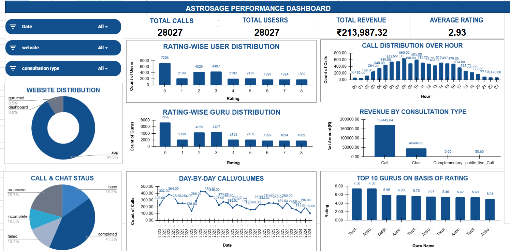

# 📊 Spreadsheet – Call Data Analysis Dashboard

This project focuses on analyzing historical call and chat data using Google Sheets.

## 🖼 Dashboard Preview

## 🎯 Project Objectives

- Analyze historical call data.
- Understand customer interaction patterns.
- Evaluate revenue generation.
- Analyze customer satisfaction.

## 📊 Key Performance Indicators

| Metrics | Values |
|---|---:|
| Total Calls | 28,027 |
| Total Users | 28,027 |
| Total Revenue | ₹2,13,987.32 |
| Average Rating | 2.93 |

## 🛠 Tools Used

- Google Sheets
- Data Cleaning
- Pivot Tables
- Data Analysis
- Data Visualization
- Dashboarding
